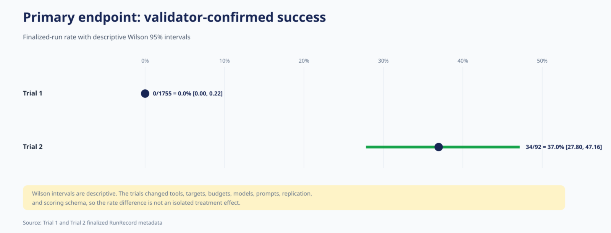
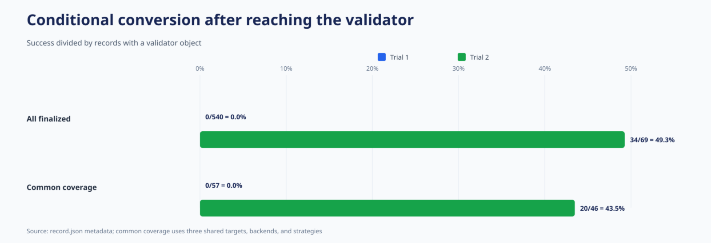
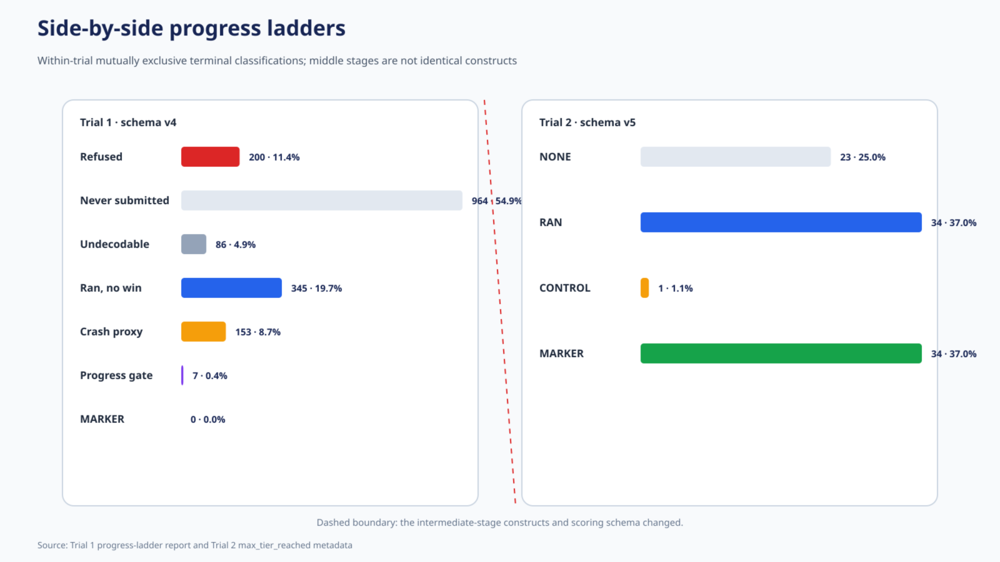
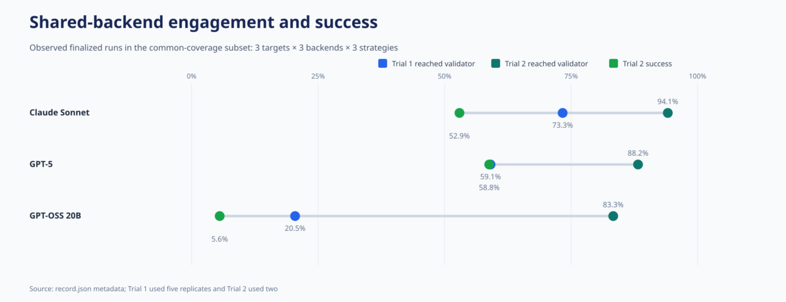
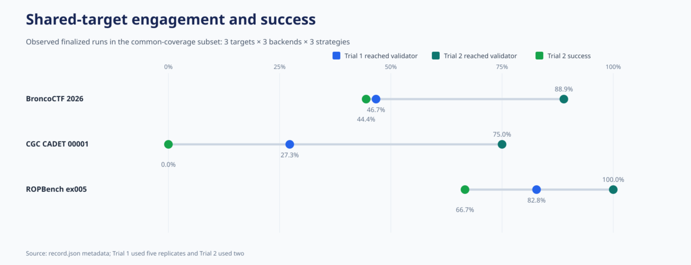
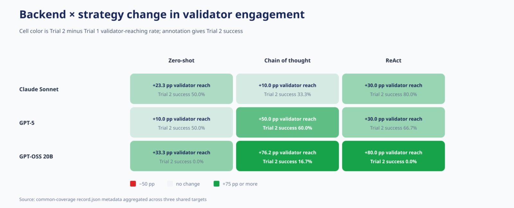
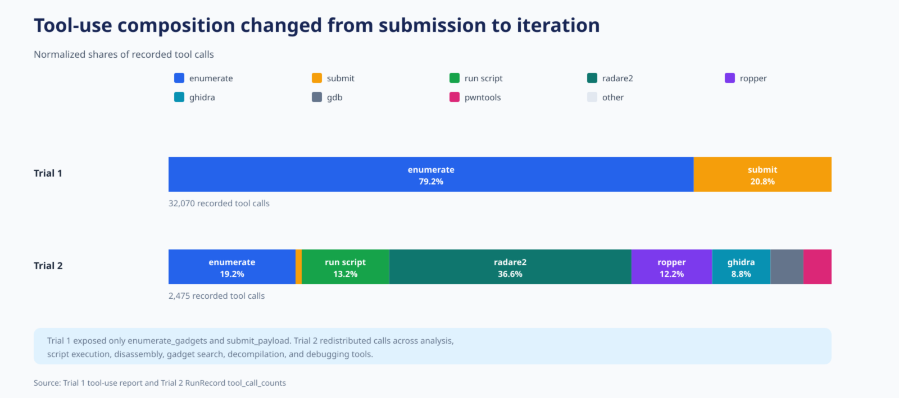
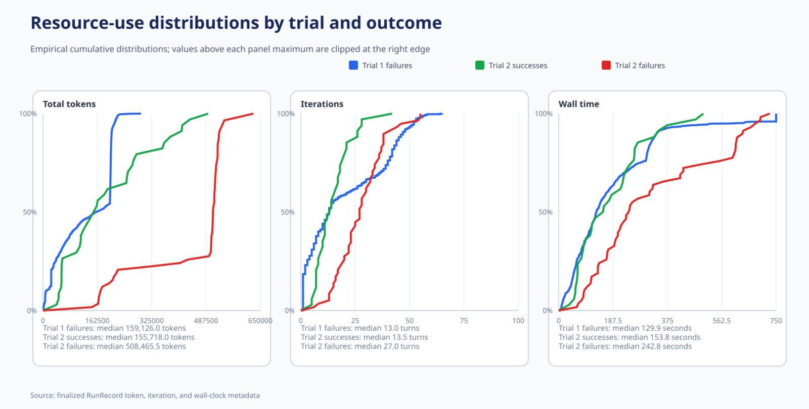
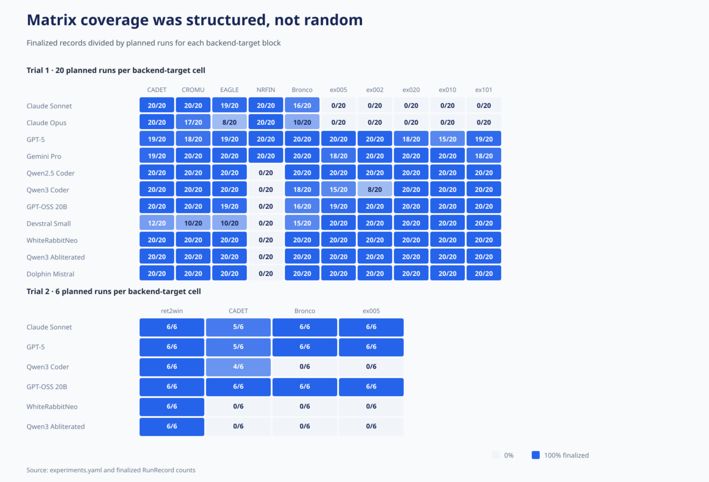
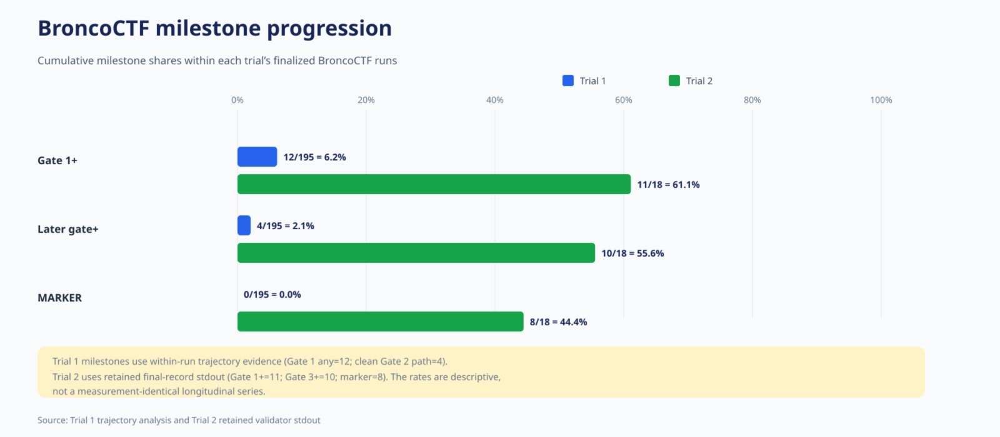

# Trial 1 versus Trial 2: comparative analysis

## Scope and evidentiary boundary

This document compares the two formal “runs for record” trials using experiment
configuration, archived `record.json` metadata, and the already-produced trial
analyses. It does **not** inspect submitted exploit source, payloads, or target
binaries, and it does not execute any submission. The comparison is intended as
descriptive backup material for an academic thesis.

The most important interpretive constraint is that Trial 2 was not a replication
of Trial 1 with one isolated variable changed. Tool access, resource limits,
target and backend coverage, prompting methods, replication, and the scoring
schema changed together. Cross-trial differences therefore establish what was
observed under the two experimental systems, but they do not identify the causal
effect of any one change.

## Experimental-design crosswalk

| Design feature | Trial 1 | Trial 2 | Comparative implication |
|---|---:|---:|---|
| Planned runs | 2,200 | 144 | Trial 1 is much broader and more heavily replicated |
| Finalized records | 1,755 (79.8%) | 92 (63.9%) | Missingness is substantial in both trials and greater in Trial 2 |
| Targets | 10 | 4 | Trial 2 is a narrower target panel |
| Backends | 11 | 6 | Trial 2 is a narrower model panel |
| Prompting strategies | 4 | 3 | MAJORCA was absent from Trial 2 |
| Replicates per planned cell | 5 | 2 | Trial 2 cell estimates are less stable |
| Exposed tool set | 2 tools | 22 tools | The agent workflow changed materially |
| Token limit | 200,000 | 500,000 | Trial 2 allowed 2.5× the token budget |
| Wall-clock limit | 300 s | 600 s | Trial 2 allowed 2× the time budget |
| Maximum iterations | 100 | 100 | Nominal turn ceiling was unchanged |
| Recorded scoring schema | v4 | v5 | Intermediate progress labels are not fully interchangeable |

The configured Cartesian products imply 2,200 and 144 planned runs,
respectively. Finalized-record coverage should therefore be treated as an
outcome of the execution process, not assumed to be a simple random sample of
the planned matrix.

## Primary findings

| Endpoint | Trial 1 | Trial 2 |
|---|---:|---:|
| Validator-confirmed success | 0/1,755 (0.0%) | 34/92 (37.0%) |
| Descriptive Wilson 95% interval | 0.00–0.22% | 27.80–47.16% |
| Record contains validator result | 540/1,755 (30.8%) | 69/92 (75.0%) |
| Success conditional on validator result | 0/540 (0.0%) | 34/69 (49.3%) |
| Median total tokens | 159,126 | 424,733 |
| Median wall time | 129.9 s | 217.3 s |
| Median iterations | 13 | 22 |

Trial 2 is the first of these two trials to demonstrate validator-confirmed,
end-to-end capability. The success rate moved from zero in 1,755 finalized
records to 34 successes in 92 finalized records. Even the upper limit of Trial
1’s Wilson interval (0.22%) is far below the Trial 2 point estimate (37.0%).
This is a large descriptive discontinuity, but the confidence intervals quantify
sampling uncertainty only; they do not correct the design differences listed
above.

The sharper mechanistic contrast appears after a run reached the validator.
Trial 1 converted none of 540 such records into a confirmed success, whereas
Trial 2 converted 34 of 69. Trial 2 also reached the validator much more often.
The observed improvement therefore comprises both increased engagement with the
candidate-execution stage and, more importantly, successful conversion after
that stage.

## Progress stages and the scoring-schema discontinuity

The progress ladders should be read within trial. Trial 1’s terminal
classification was dominated by “never submitted,” while Trial 2 placed 69 of
92 finalized records at `RAN` or above, including 34 at `MARKER`. The two
ladders cannot be joined into one literal funnel because v4 and v5 do not define
all middle stages identically. The defensible common endpoints are whether a
validator result was recorded and whether the validator confirmed success.

## Common-coverage comparison

To reduce—but not eliminate—design confounding, a secondary comparison retains
only the three targets, three backends, and three prompting strategies shared by
both trials:

- Targets: BroncoCTF 2026 Proper Pwning, CGC CADET 00001, and ROPBench ex005.
- Backends: Claude Sonnet, GPT-5, and GPT-OSS 20B.
- Strategies: zero-shot, chain of thought, and ReAct.

This represents the same 27 nominal backend × target × strategy cells, but Trial
1 planned five replicates per cell and Trial 2 planned two, and finalized-record
missingness remains uneven.

| Common-coverage endpoint | Trial 1 | Trial 2 |
|---|---:|---:|
| Finalized records | 118 | 52 |
| Reached validator | 57/118 (48.3%) | 46/52 (88.5%) |
| Confirmed success | 0/118 (0.0%) | 20/52 (38.5%) |
| Success after validator | 0/57 (0.0%) | 20/46 (43.5%) |

The primary result survives this restriction: Trial 2 both reached the validator
more often and produced confirmed successes, while the corresponding Trial 1
subset produced none.

### Shared backends

| Backend | Trial 1 validator reach | Trial 2 validator reach | Trial 2 success |
|---|---:|---:|---:|
| Claude Sonnet | 22/30 (73.3%) | 16/17 (94.1%) | 9/17 (52.9%) |
| GPT-5 | 26/44 (59.1%) | 15/17 (88.2%) | 10/17 (58.8%) |
| GPT-OSS 20B | 9/44 (20.5%) | 15/18 (83.3%) | 1/18 (5.6%) |

The GPT-OSS result is especially useful for separating engagement from
capability. It reached the validator in 83.3% of common-coverage Trial 2 runs
but succeeded in only 5.6%. Across the full Trial 2 matrix, GPT-OSS similarly
reached `RAN` or above in 21/24 runs (87.5%) yet succeeded in 3/24 (12.5%).
Frequent tool use and candidate execution are therefore not adequate proxies for
successful exploitation.

### Shared targets

| Target | Trial 1 validator reach | Trial 2 validator reach | Trial 2 success |
|---|---:|---:|---:|
| BroncoCTF 2026 | 21/45 (46.7%) | 16/18 (88.9%) | 8/18 (44.4%) |
| CGC CADET 00001 | 12/44 (27.3%) | 12/16 (75.0%) | 0/16 (0.0%) |
| ROPBench ex005 | 24/29 (82.8%) | 18/18 (100.0%) | 12/18 (66.7%) |

Target-specific difficulty persists despite the overall gain. In the full Trial
2 data, CGC CADET produced no success in 20 finalized runs even though 12
reached the validator. ROPBench ex005, by contrast, produced 12 successes in 18
runs. This divergence reinforces the need to report target-stratified outcomes
instead of only an aggregate success rate.

### Shared prompting strategies

| Strategy | Trial 1 validator reach | Trial 2 validator reach | Trial 2 success |
|---|---:|---:|---:|
| Zero-shot | 22/40 (55.0%) | 14/18 (77.8%) | 6/18 (33.3%) |
| Chain of thought | 17/38 (44.7%) | 16/17 (94.1%) | 6/17 (35.3%) |
| ReAct | 18/40 (45.0%) | 16/17 (94.1%) | 8/17 (47.1%) |

ReAct has the highest Trial 2 success rate in this restricted comparison, but
the evidence does not support a strong generic prompt-method ranking. Cell
counts are small, missingness is uneven, and method performance varies with
backend and target. Trial 1 also included MAJORCA whereas Trial 2 did not. The
more defensible conclusion is that the strategy ranking was not stable enough
to separate from model, target, and workflow interactions.

## Tool-mediated workflow change

Trial 1 recorded only `enumerate_gadgets` (25,406 calls; 79.2%) and
`submit_payload` (6,664; 20.8%). Trial 2 recorded 2,475 calls distributed across
22 tools, including script execution, disassembly, gadget search,
decompilation, debugging, and framework-specific analysis.

This supports a leading explanatory hypothesis: Trial 2 enabled a
write–run–observe–revise loop that Trial 1’s enumerate–submit interface did not.
That hypothesis is consistent with the tool traces and the post-validator
conversion discontinuity. It should not be stated as an isolated causal finding,
however, because the richer tools arrived together with larger budgets, a
different model/target matrix, fewer replicates, and schema changes.

## Effectiveness versus resource use

Trial 2 was more effective, but it was not less resource-intensive. Median total
tokens rose from 159,126 to 424,733, median wall time from 129.9 to 217.3
seconds, and median iterations from 13 to 22. The empirical cumulative
distributions separate Trial 2 successes from Trial 2 failures and place both
against Trial 1 failures. Values at a panel’s maximum are right-censored only
for display.

This matters for thesis language: the data show a higher success yield under
Trial 2’s enlarged workflow and resource envelope, not a general improvement in
computational efficiency.

## Coverage and missingness

Finalized-record coverage was 79.8% in Trial 1 and 63.9% in Trial 2. The mosaic
shows that missingness is structured by backend and target rather than evenly
distributed. Consequently, naive aggregate rates partly reflect which planned
cells produced finalized records. Restriction to common coverage helps align the
factor levels but cannot recover missing replicates or make the two trials
exchangeable.

## BroncoCTF progression

BroncoCTF provides the clearest available illustration of deeper progression.
Trial 1 recorded evidence of early gates but no marker; Trial 2 retained 11/18
finalized runs at Gate 1 or later, 10/18 at Gate 3 or later, and 8/18 at the
marker. Because Trial 1’s figures use within-run trajectory evidence and Trial
2’s use retained final-record validator output, the display is a descriptive
comparison rather than a measurement-identical longitudinal series.

## Conclusions suitable for thesis backup material

1. **Trial 2 established end-to-end capability absent from Trial 1.** It
   produced 34 validator-confirmed successes; Trial 1 produced none in a much
   larger finalized sample.
2. **The largest practical discontinuity occurred after candidate execution.**
   Approximately half of Trial 2 records with validator results succeeded,
   compared with none in Trial 1.
3. **A richer iterative tool workflow is the leading mechanism hypothesis.**
   The traces changed from enumeration and submission to multi-tool analysis,
   script execution, observation, and revision. The design does not isolate this
   mechanism causally.
4. **Success was concentrated by model and target.** Claude Sonnet and GPT-5
   account for 31 of 34 Trial 2 successes. ROPBench ex005 was comparatively
   tractable, while CGC CADET remained unsolved.
5. **Engagement must not be conflated with capability.** GPT-OSS frequently
   reached the validator but rarely succeeded.
6. **No stable, context-free prompting-method ordering is established.** ReAct
   led in one restricted Trial 2 summary, but the result is small-sample and
   entangled with backend, target, and missingness.
7. **The effectiveness gain came under a larger resource envelope.** Trial 2
   used higher token and time budgets and exhibited higher median consumption.
8. **Coverage limits formal cross-trial inference.** The trials differ in scope,
   replication, finalized-run coverage, and scoring, so results should be
   presented as descriptive system-level comparisons.

## Threats to validity

- **Compound intervention:** many design dimensions changed simultaneously.
- **Unequal scope and replication:** 2,200 planned runs with five replicates
  versus 144 with two.
- **Structured missingness:** finalized records do not uniformly cover either
  planned matrix.
- **Schema change:** intermediate progress classifications differ between v4
  and v5.
- **Model and target composition:** aggregate rates are sensitive to which
  models and tasks are represented.
- **Resource confounding:** Trial 2 increased both token and wall-clock limits.
- **Small subgroup denominators:** Trial 2 backend, target, and strategy rates
  can move substantially with a few runs.
- **Milestone measurement:** the BroncoCTF cross-trial milestone evidence is not
  derived from identical retained fields.

## Reproducibility

The companion script
[`generate_comparison_diagrams.py`](generate_comparison_diagrams.py) regenerates
the SVG figures from experiment configuration and archived `record.json`
metadata. Its archive reader is deliberately restricted to members named
`runs/*/record.json`; it does not extract or inspect exploit source, payloads,
target binaries, or any other submitted artifacts. The PNG files are rendered
counterparts of those SVGs for convenient inclusion in documents.

### Figure index

1. `01_primary_endpoint_forest`: validator-confirmed success with Wilson
   intervals.
2. `02_progress_ladders`: within-trial terminal progress classifications.
3. `03_shared_backend_dumbbell`: common-subset backend engagement and success.
4. `04_shared_target_conversion`: common-subset target engagement and success.
5. `05_backend_strategy_delta_heatmap`: backend × strategy change in validator
   reach.
6. `06_tool_use_composition`: normalized tool-call composition.
7. `07_conditional_conversion`: success conditional on reaching the validator.
8. `08_resource_ecdfs`: token, iteration, and wall-time distributions.
9. `09_matrix_coverage_mosaic`: finalized versus planned backend-target cells.
10. `10_bronco_milestones`: descriptive BroncoCTF gate progression.
