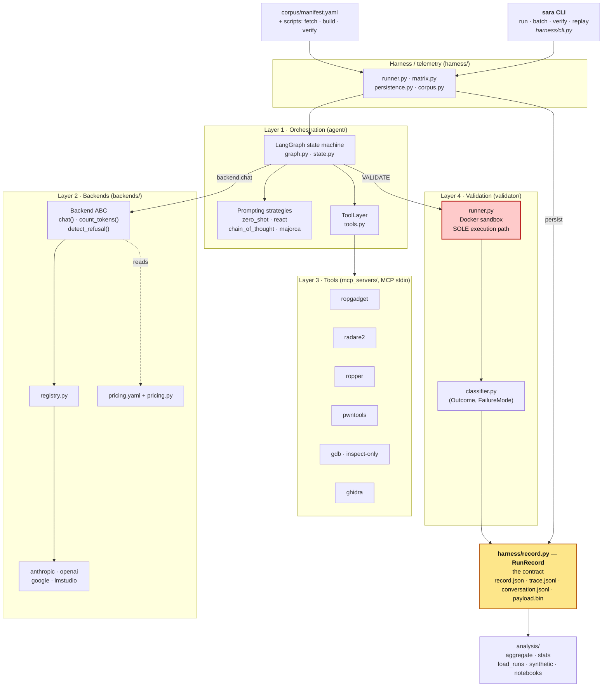
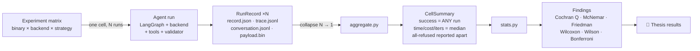
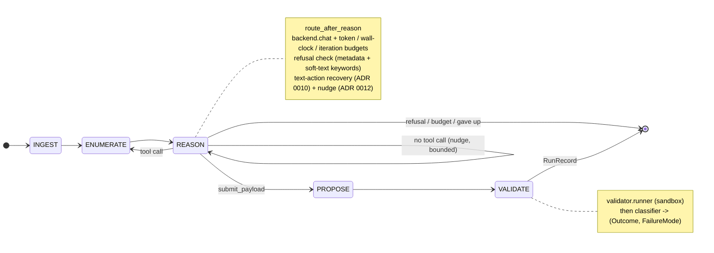
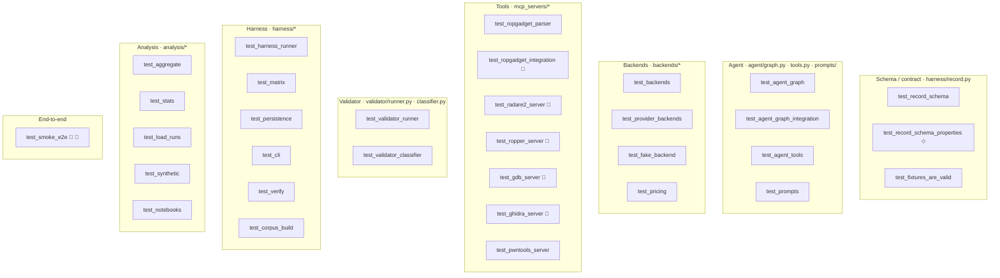
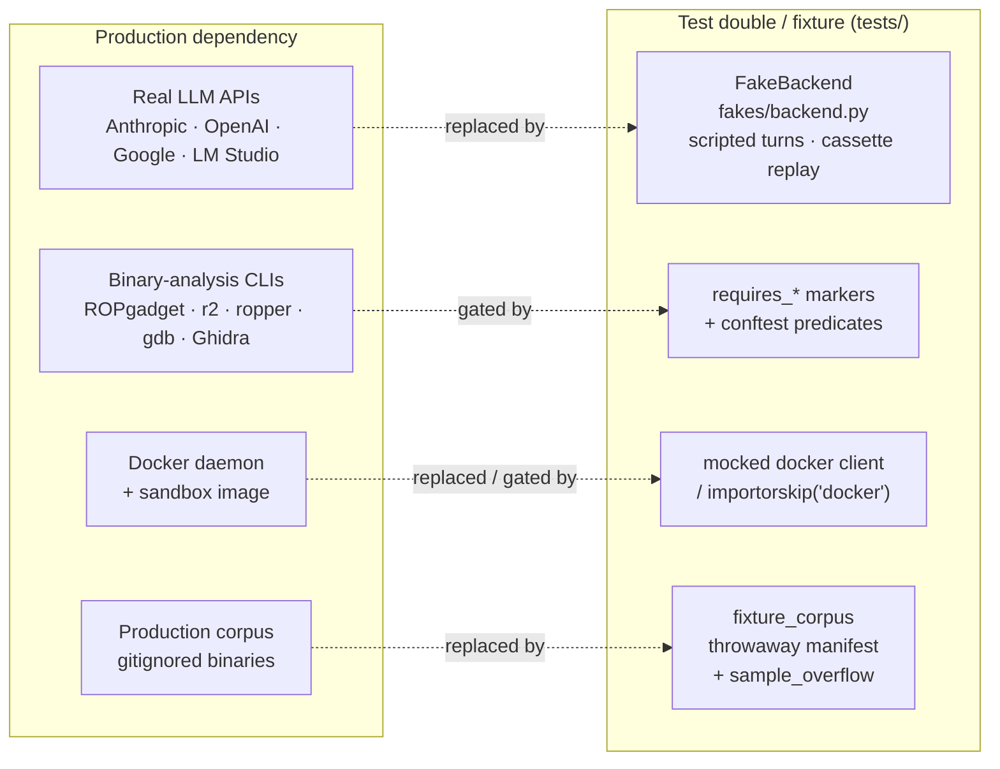
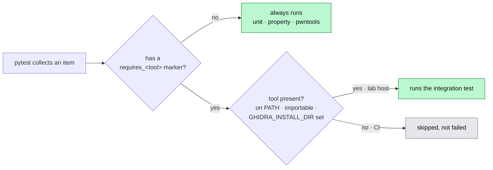

# SARA architecture diagrams

Visual companions to [`ARCHITECTURE.md`](ARCHITECTURE.md) (the prose reference)
and [`INFRASTRUCTURE_PLAN.md`](INFRASTRUCTURE_PLAN.md) (the rationale). Every
diagram below is [Mermaid](https://mermaid.js.org/) — it renders inline on GitHub
and in most IDE Markdown previews.

- [Repository architecture](#repository-architecture)
  - [1. System architecture — four layers + the contract](#1-system-architecture--four-layers--the-contract)
  - [2. Experiment data flow (one direction)](#2-experiment-data-flow-one-direction)
  - [3. Agent loop — the LangGraph state machine](#3-agent-loop--the-langgraph-state-machine)
- [Test architecture](#test-architecture)
  - [4. Test-suite coverage map](#4-test-suite-coverage-map)
  - [5. Test doubles and the CI-vs-lab gating](#5-test-doubles-and-the-ci-vs-lab-gating)

---

## Repository architecture

### 1. System architecture — four layers + the contract

Each layer exposes a narrow interface to the one above, so a swap at one layer
does not ripple into the others. Two invariants are highlighted: the
**`RunRecord` schema is the single contract** (amber) that everything upstream
serialises into and everything downstream reads from, and the **validator is the
sole execution path** (red) — no other component may run a payload (ADR 0002).

### 2. Experiment data flow (one direction)

The matrix is `(binary × backend × strategy)`; each cell runs **N = 5** times and
emits one `RunRecord` per run. Data flows strictly left to right — no component
reads back upstream. The `RunRecord` is the seam between *running* experiments
and *analysing* them.

### 3. Agent loop — the LangGraph state machine

The graph shape **is** the methodology. Each node is a pure
`AgentState → AgentState` function; `REASON` is the hub, routed by
`route_after_reason`. The shape is fixed — new prompting strategies and tools
extend the layers without changing it (ADR 0001). `ENUMERATE` seeds a baseline
gadget dump as *user context* (ADR 0011); Step 8 added a bounded `REASON→REASON`
nudge self-loop (ADR 0012) and text-format tool-call recovery (ADR 0010) without
adding nodes.

---

## Test architecture

The suite is **379 tests** in [`tests/`](../tests), one
`tests/test_<module>.py` per subsystem, all green. Tests never touch real API
keys or the gitignored production corpus: LLM calls replay through a
`FakeBackend`, the corpus is a throwaway fixture, and the binary-analysis CLIs
are gated by markers so the tests **skip** (not fail) where a tool is absent.

### 4. Test-suite coverage map

Each box is a subsystem-under-test titled with the module(s) it exercises; the
nodes inside are the test files that cover it. Badges: **⬦** Hypothesis
property test, **🔧** tool-gated integration (skips on CI, runs on the lab host),
**🐳** Docker-gated (needs the daemon + built sandbox image).

### 5. Test doubles and the CI-vs-lab gating

**What stands in for production dependencies.** Every expensive or non-portable
dependency has a test double or fixture, all wired up by
[`tests/conftest.py`](../tests/conftest.py):

Shared scaffolding those doubles draw on:
[`fakes/cassettes/*.jsonl`](../tests/fakes/cassettes) (recorded turns),
[`strategies.py`](../tests/strategies.py) (Hypothesis generators),
[`fixtures/run_records/*.json`](../tests/fixtures/run_records) (golden records),
and [`fixtures/binaries/sample_overflow`](../tests/fixtures/binaries) (the built
fixture binary + its `chain.json`).

**How the tool gate decides at collection time.** `pytest_collection_modifyitems`
in `conftest.py` maps each `requires_<tool>` marker to a presence predicate and
adds a skip when the tool is missing — so the same suite runs fully on the lab
host and skips the integration tests on CI, without ever failing there.

