# SARA paper-diagram candidates

This directory contains three publication-oriented raster variants for each of
nine architecture subjects. All figures were generated from the repository
implementation and documentation, then visually checked for label and flow
accuracy.

## Variant key

- **A — clean schematic:** direct, presentation-friendly vector-style flow.
- **B — journal figure:** denser conceptual or contract-oriented organization.
- **C — technical blueprint:** restrained drafting-grid treatment with numbered
  or strongly structured stages.

## System architecture

| A — layered | B — contract | C — blueprint |
|---|---|---|
|  | 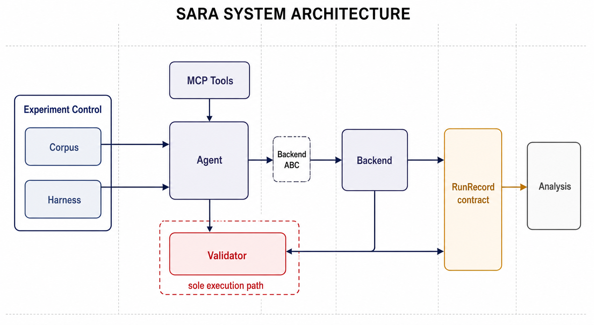 | 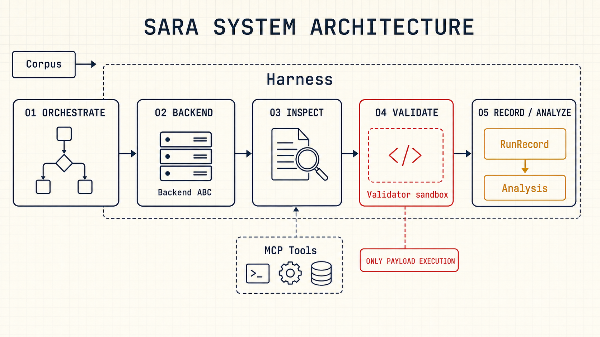 |

## Experiment data flow

| A — layered | B — contract | C — blueprint |
|---|---|---|
|  | 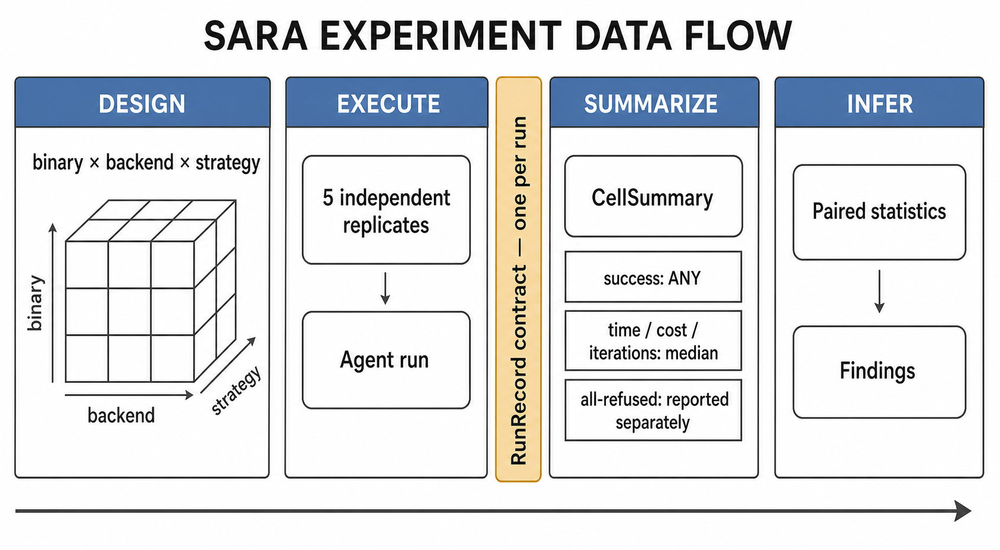 | 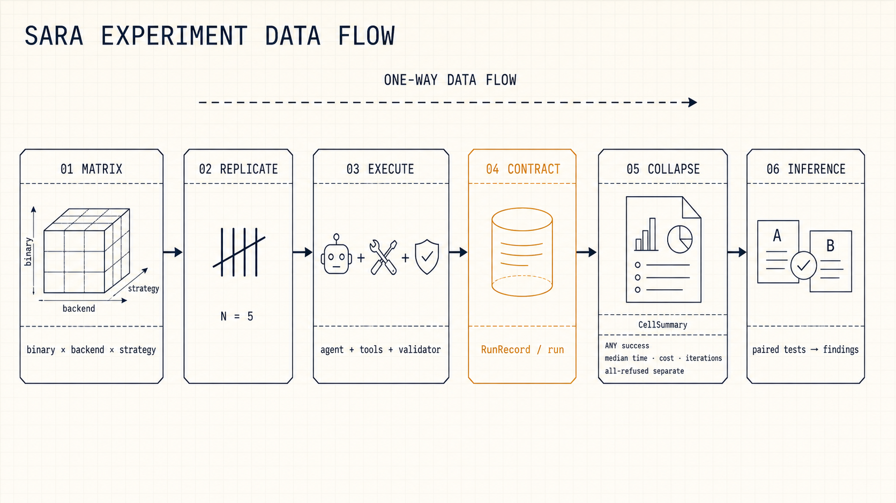 |

## Agent loop

| A — clean flow | B — journal process | C — blueprint |
|---|---|---|
|  | 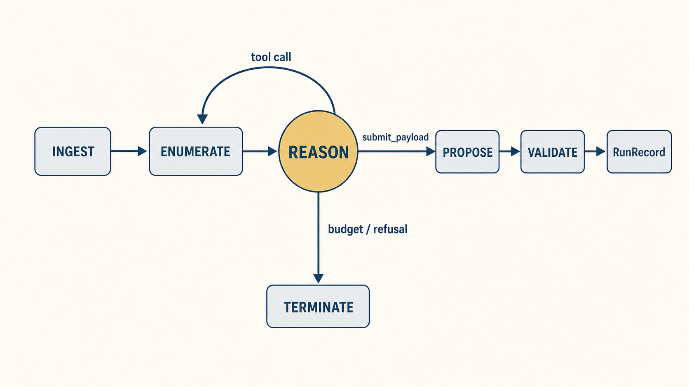 | 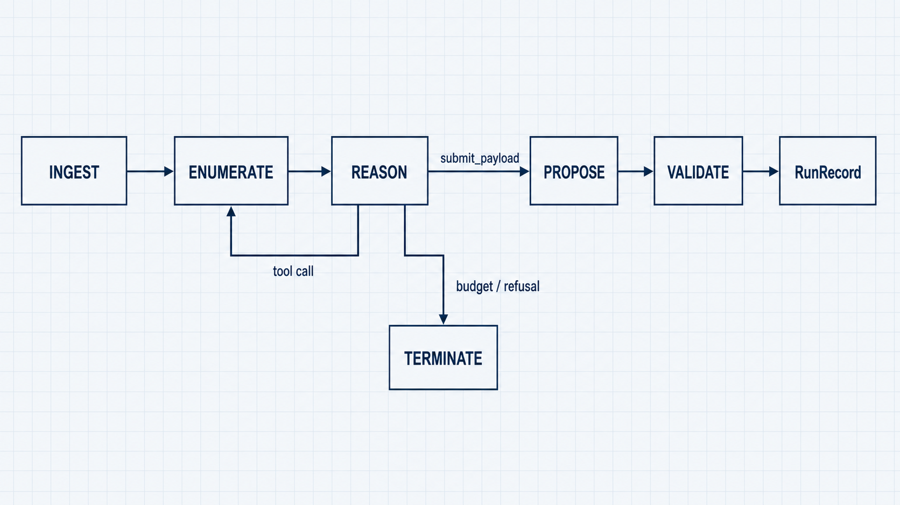 |

## Zero-shot prompting

| A — clean flow | B — journal comparison | C — blueprint |
|---|---|---|
|  | 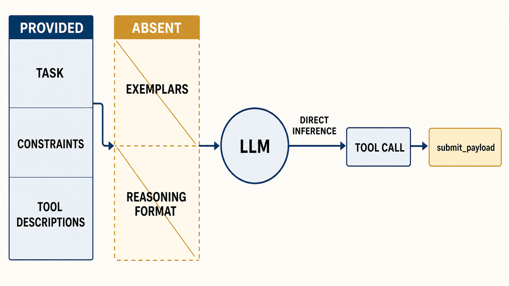 | 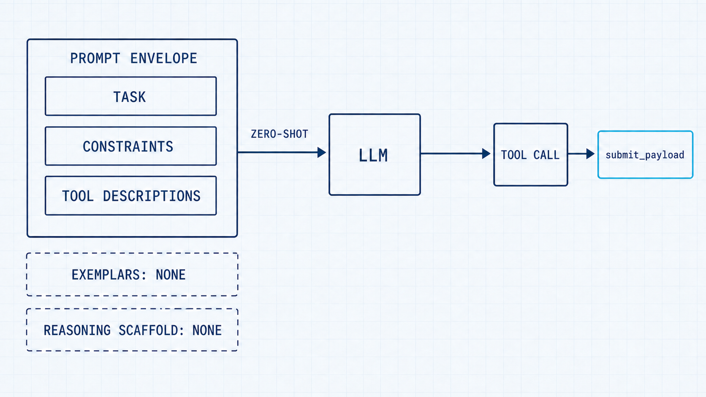 |

## Chain-of-thought prompting

| A — clean flow | B — journal cycle | C — blueprint |
|---|---|---|
|  | 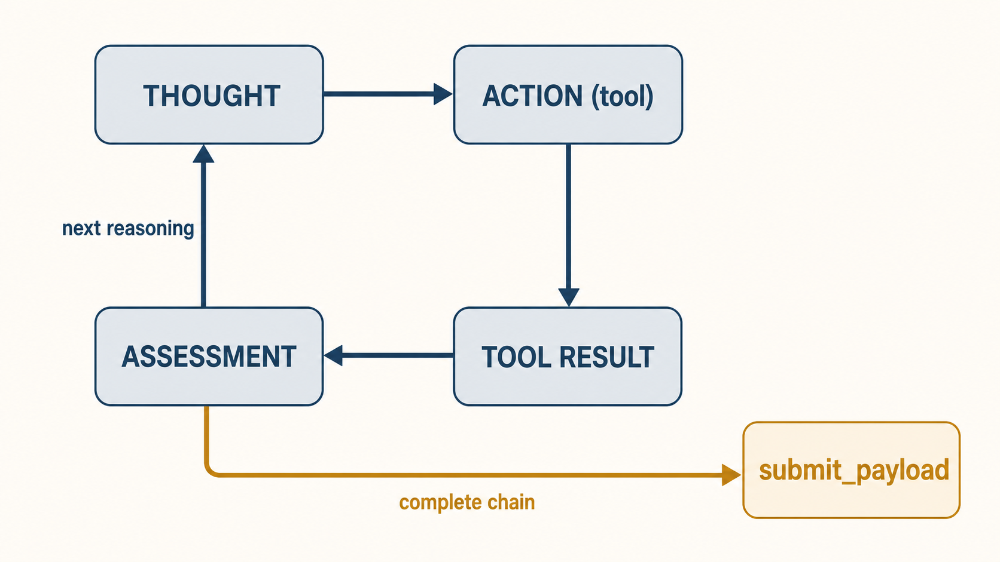 | 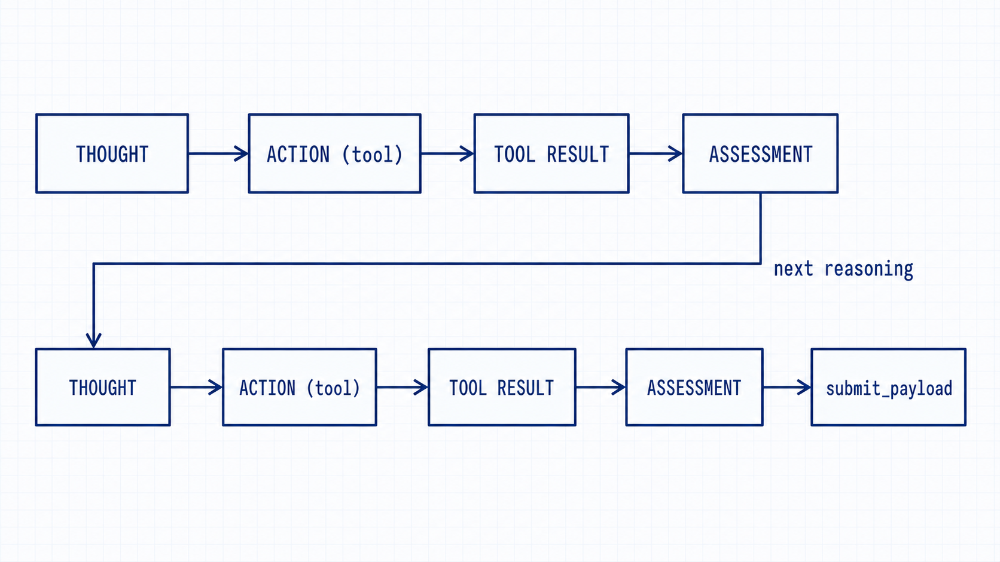 |

## ReAct prompting

| A — vector workflow | B — journal loop | C — blueprint |
|---|---|---|
|  | 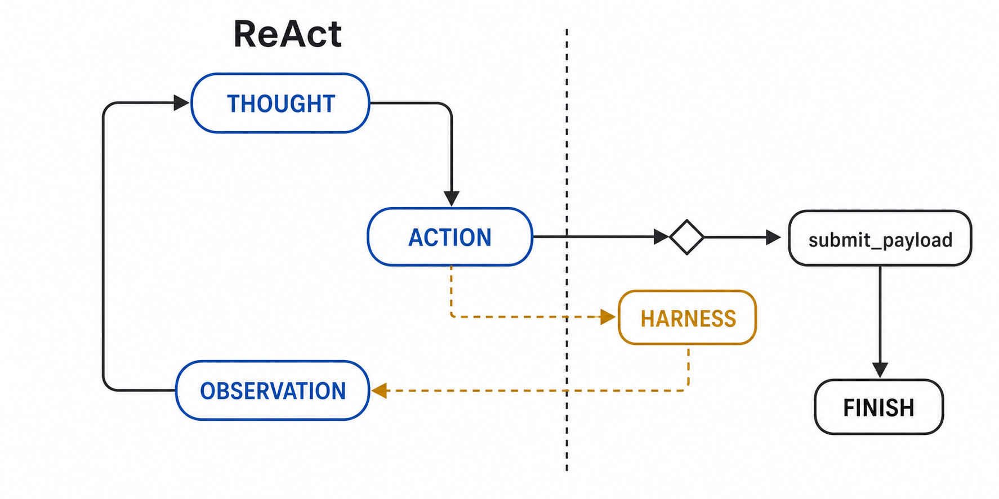 | 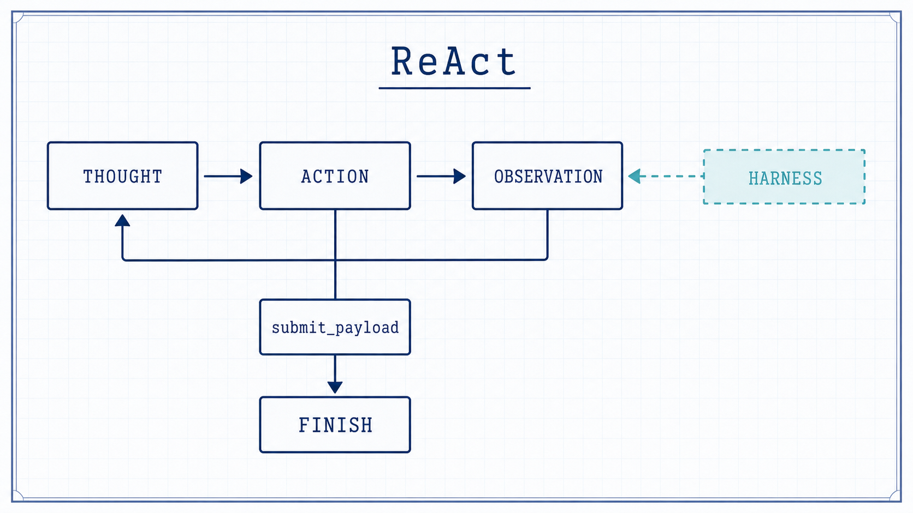 |

## MAJORCA prompting

| A — vector workflow | B — journal DAG | C — blueprint |
|---|---|---|
|  | 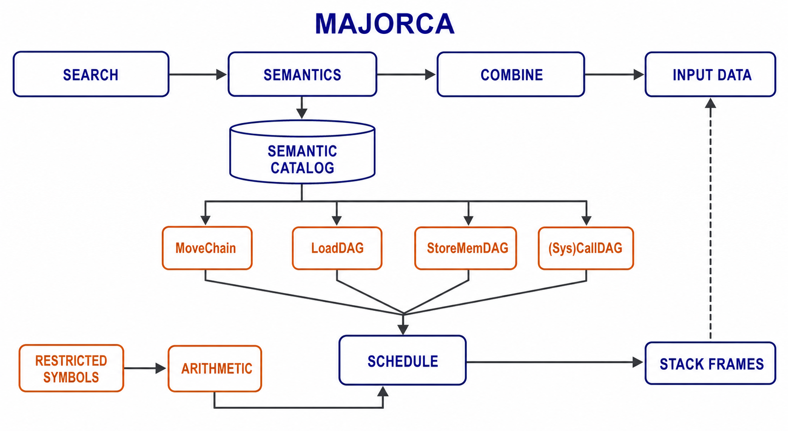 | 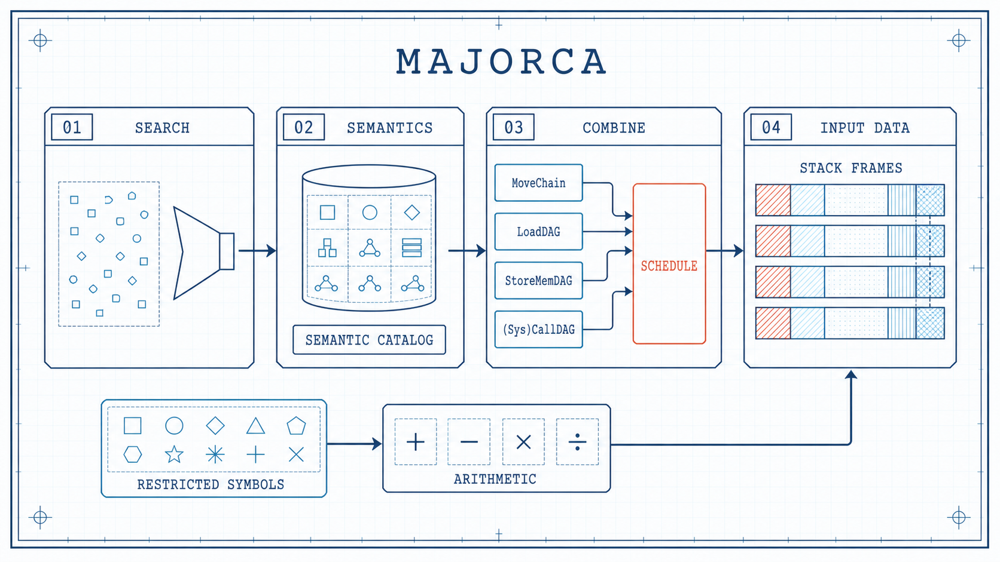 |

## Corpus sources and provenance

| A — vector workflow | B — journal DAG | C — blueprint |
|---|---|---|
|  | 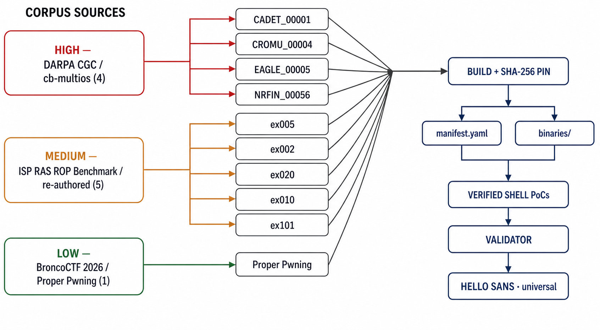 | 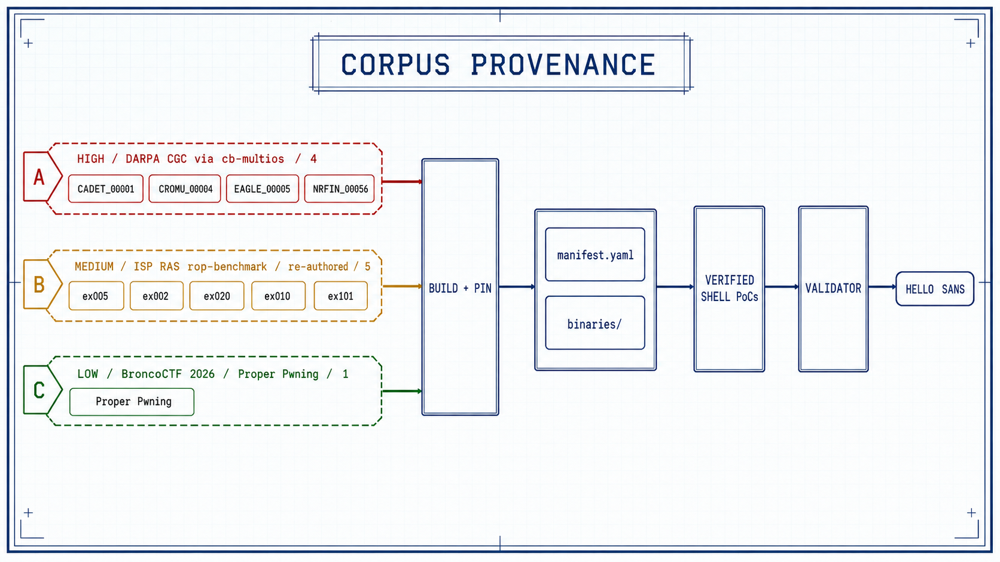 |

## Swappable LLM backends

| A — layered | B — contract | C — blueprint |
|---|---|---|
|  | 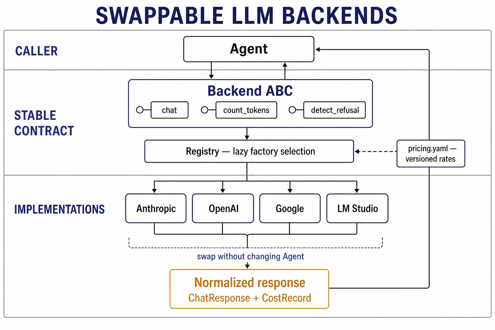 | 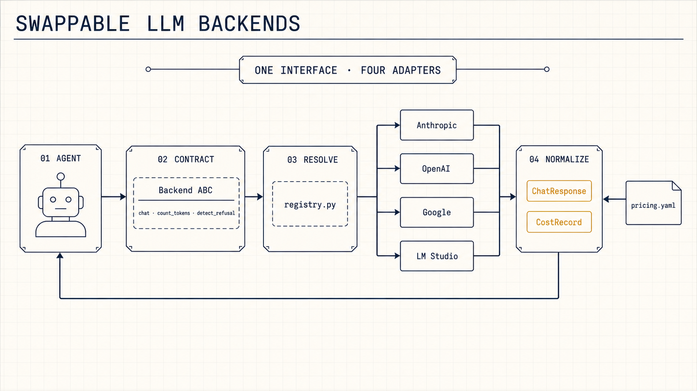 |

## Prompt specification

All variants used the built-in image-generation path with the
`infographic-diagram` use case. The shared specification requested a landscape
academic-paper figure, restrained dark-on-light colors, crisp readable
typography, exact minimal labels, generous whitespace, and no logos, watermark,
decorative illustration, gradients, or 3D effects. Each subject's nodes and
edges were derived from `docs/ARCHITECTURE.md`, `docs/DIAGRAMS.md`, the four
prompt strategy modules, `corpus/manifest.yaml`, `corpus/README.md`, and the
backend interface and registry.

Subject-specific prompt content:

- **System architecture:** four layers, the `RunRecord` contract, corpus and
  harness inputs, analysis output, and validator as the sole payload-execution
  path.
- **Experiment data flow:** binary × backend × strategy, five replicates per
  cell, one `RunRecord` per run, `ANY`-success and median aggregation rules,
  refusal separation, paired statistics, and findings.
- **Agent loop:** `INGEST → ENUMERATE → REASON`, tool-call return to
  `ENUMERATE`, `submit_payload → PROPOSE → VALIDATE → RunRecord`, and
  budget/refusal termination.
- **Zero-shot:** task, constraints, and tool descriptions supplied directly to
  the model, explicitly without exemplars or a reasoning scaffold.
- **Chain-of-thought:** repeated
  `THOUGHT → ACTION → TOOL RESULT → ASSESSMENT` cycles ending in
  `submit_payload`.
- **ReAct:** `THOUGHT → ACTION → OBSERVATION` loop, with observations supplied
  by the harness and `submit_payload` as the terminal action.
- **MAJORCA:** ordered search, semantics, combination, and input-data stages;
  semantic catalog; four chain/DAG types; scheduling; stack frames; and the
  restricted-symbol arithmetic path.
- **Corpus provenance:** high-leakage CGC/cb-multios (4), medium-leakage
  re-authored ISP RAS rop-benchmark targets (5), and low-leakage BroncoCTF
  Proper Pwning (1), followed by build/pin, verification, validation, and the
  universal `HELLO SANS` marker.
- **LLM backends:** agent, `Backend` ABC methods, lazy registry, Anthropic,
  OpenAI, Google, and LM Studio adapters, versioned pricing, and normalized
  `ChatResponse` plus `CostRecord` output.
